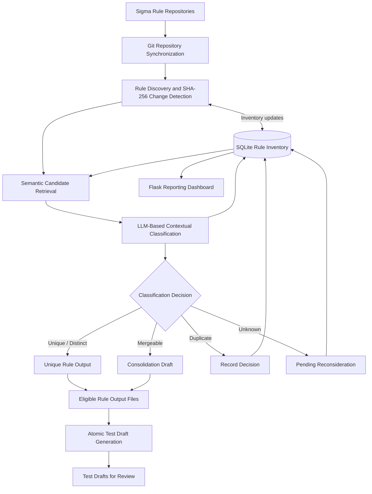

<h1 align="center">Sigma Genie</h1>

<h3 align="center">LLM-Powered Sigma Rule Analysis, Optimization & Test Drafting</h3>

AI-assisted detection engineering for security operations teams.

  
  
  
  
  

> **Project Type:** Freelance AI Engineering Project  
> **Repository Type:** Technical Portfolio & Architecture Showcase  
> **Source Availability:** Proprietary implementation; source code is not publicly available.

---

## Project Overview

Sigma Genie is a Python-based application that uses Large Language Models (LLMs) and semantic similarity to assist with the review and optimization of Sigma detection rules.

It combines Git repository synchronization, incremental change tracking, embedding-based candidate retrieval, contextual rule classification, consolidation drafting, and a separate reporting dashboard. The workflow produces review artifacts for detection engineers rather than automatically deploying or validating detection rules in a SIEM.

### Dashboard Preview

The Flask reporting dashboard displays rule inventory statistics, classification statuses, and recorded processing information.

*Screenshot from processing publicly available Sigma rule repositories. The displayed counts reflect recorded inventory and processing states. The “Atomic Test Coverage” indicator does not establish successful test execution or validated detection coverage. Interactive filtering and export features are not presented as verified functionality of the audited code version.*

## Business Problem

Maintaining detection rules across multiple repositories creates several challenges:

- Duplicate and overlapping detection logic.
- Repetitive manual rule comparison and maintenance.
- Inconsistent rule organization.
- Difficulty identifying changes between processing runs.
- Limited visibility into the rule inventory and review status.

Sigma Genie addresses these challenges by preparing relevant rule comparisons and consolidation drafts for analyst review.

## My Contributions

**Role: Sole AI Engineer & End-to-End Developer**

Independently designed, developed, tested, and delivered the application as a freelance AI engineering project, taking ownership of its architecture and implementation.

### System Architecture & AI Engineering

- Designed the end-to-end batch processing architecture and rule analysis workflow.
- Integrated Google Gemini for contextual analysis of detection-rule relationships and consolidation drafting.
- Implemented embedding-based candidate retrieval using cosine similarity.
- Developed rule-level classification and pairwise relationship analysis to identify unique, duplicate, and potentially mergeable content.

### Backend & Automation

- Implemented Git repository synchronization, YAML discovery, and SHA-256-based change detection.
- Built SQLite-backed rule inventory and persistent processing-state management.
- Developed generation of Atomic Red Team-style test drafts for eligible rule outputs.
- Integrated retrieval, model inference, status tracking, file generation, and reporting components.

### Dashboard & Delivery

- Developed a Flask-based dashboard for rule inventory and processing-status reporting.
- Performed integration testing and debugging during development.
- Prepared the application for deployment and delivered it to the client.

**Project Status:** Successfully delivered and deployed in the client's environment, with operational status confirmed by the client.

## Key Capabilities

| Capability | Description |
| --- | --- |
| Repository Synchronization | Clones or updates configured Git rule repositories. |
| Incremental Processing | Identifies new and modified YAML files using content hashes. |
| Semantic Candidate Retrieval | Uses embeddings and cosine similarity to shortlist relevant rules. |
| LLM-Based Classification | Produces contextual rule-level decisions and candidate relationships. |
| Consolidation Drafting | Generates proposed merged Sigma YAML for review when rules are classified as mergeable. |
| Test Draft Generation | Generates Atomic Red Team-style drafts for eligible rule output files; no automated test execution is claimed. |
| Persistent Rule Inventory | Stores file metadata, hashes, and processing statuses in SQLite. |
| Reporting Dashboard | Displays server-rendered inventory metrics, status summaries, and recent rule records. |

## System Architecture

Sigma Genie combines deterministic file processing, semantic retrieval, LLM-assisted decisions, persistent state management, and review-oriented outputs.

### Architecture Highlights

- **Incremental Processing:** SHA-256 fingerprints help detect new and modified rule files.
- **Semantic Retrieval:** Embedding similarity shortlists comparison candidates before LLM analysis.
- **Hybrid Decision-Making:** Deterministic processing works alongside LLM-based classification and drafting.
- **Persistent State:** SQLite maintains rule metadata and processing status across batch runs.
- **Review Artifacts:** Unique rule files, consolidation drafts, and test drafts support analyst review.
- **Reporting:** A separate Flask application provides an overview of rule inventory and processing status.

> This diagram is a high-level conceptual view. It omits proprietary prompts, operational configuration, customer information, and implementation details. Test drafts are not automatically executed or validated.

## AI & Machine Learning Approach

### Semantic Candidate Retrieval

The workflow uses embeddings and cosine similarity to select potentially related rules before contextual LLM comparison. Candidate selection is bounded to control the comparison context; it is not an exhaustive similarity assessment of every rule.

### Contextual Classification

Google Gemini assesses a target rule against selected candidates and returns a rule-level decision along with relationships to individual candidates. These model-generated decisions are recommendations, not independently validated detection-quality measurements.

### Hybrid Engineering Approach

SHA-256 hashing identifies file revisions, SQLite tracks processing state, embeddings select candidate comparisons, and an LLM analyzes relationships and drafts consolidated content where applicable.

## Engineering Highlights

- End-to-end integration of Git ingestion, rule scanning, retrieval, inference, persistence, and file outputs.
- Incremental rule processing using content hashes and saved processing state.
- Embedding reuse, bounded candidate selection, and request limits to manage AI workload.
- Retry and quota handling for supported model-generation calls.
- Structured classification outputs for downstream processing.
- Separation of batch analysis from inventory reporting.

## Technical Stack

| Category | Technologies |
| --- | --- |
| Programming | Python |
| Generative AI | Google Gemini API |
| Semantic Retrieval | Gemini Embeddings, Cosine Similarity |
| Persistence | SQLite, JSON-based vector cache |
| Backend & Dashboard | Flask, Jinja, HTML, CSS, JavaScript |
| Repository Integration | Git |
| Data Formats | YAML, JSON |
| Security Domain | Sigma Detection Rules, Atomic Red Team-style Drafts |

## Business Value

The application is designed to:

- Reduce repetitive manual comparison of similar detection rules.
- Help analysts identify potential duplicates and overlapping detection logic.
- Prepare consolidation proposals for review rather than automatically changing upstream rules.
- Support review workflows with generated test drafts.
- Improve visibility into the inventory and processing status of detection rules.

*These are intended workflow benefits. Quantified time savings, detection accuracy, and test effectiveness have not been independently established.*

## Confidentiality

This repository is a technical portfolio and architecture showcase, not the production source-code repository.

Proprietary code, prompts, internal configuration, credentials, private repository locations, and customer-specific information are excluded. The dashboard preview uses data from public Sigma repositories.

## Author

**Ziad Muhammed Saqr**  
AI Engineer | Machine Learning & Generative AI

- [LinkedIn](https://www.linkedin.com/in/ziadmuhammedsaqr/)
- [GitHub](https://github.com/Zsaqr)
