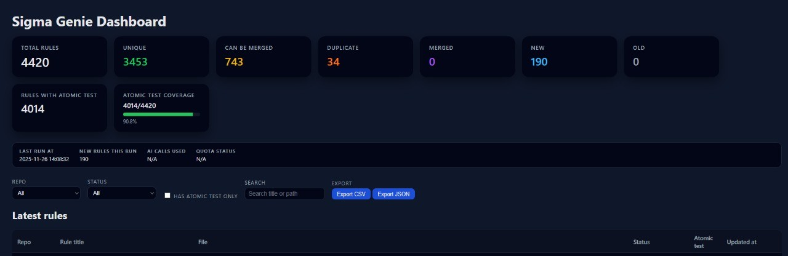

# Sigma Genie – AI-Powered Sigma Rule Optimizer & Atomic Test Generator

> **Note:**  
> This repository is a **high-level showcase** of the project architecture and capabilities.  
> The **production source code is private** and not published here.

---

## 🚀 Overview

**Sigma Genie** is an AI-powered pipeline that ingests large Sigma rule sets from multiple repositories, classifies and optimizes them using LLMs, and automatically generates **Atomic Red Team tests** linked to each rule.

It’s designed for:

- Detection engineering teams
- SOC / blue teams
- Threat hunting / content engineering
- Anyone managing **thousands of Sigma rules** across multiple repos

The actual implementation is used as a **paid/private tool**.  
This repo exists to showcase the **design, architecture, and capabilities** of the system.

---

## ✨ Key Features

- 🔁 **Multi-repo sync (GitHub + private repos)**  
  - Syncs public Sigma repos (e.g. SigmaHQ + community)  
  - Supports private GitHub repos via token  
  - Keeps a local mirror for fast analysis

- 📦 **Rule discovery & state tracking (SQLite)**  
  - Scans `.yml` / `.yaml` Sigma rules and computes content hashes  
  - Persists metadata in `rules` table (repo, path, title, hash, status, timestamps, atomic test link)  
  - Detects:
    - **new** rules  
    - **updated** rules  
    - unchanged rules (reused status)

- 🧠 **LLM-powered rule classification (Gemini)**  
  - Uses Google **Gemini 2.0 Flash** + embeddings (`text-embedding-004`)  
  - For each new/updated rule, it:
    - Finds similar candidate rules (via embeddings + family prefixes)
    - Classifies rule as:
      - `unique`
      - `can_be_merged`
      - `duplicate`
      - `distinct`
    - Produces a structured JSON-like result with:
      - `final_classification`
      - `reason`
      - `per_candidate` relationships

- 🧩 **Rule optimization & merging**
  - Writes:
    - **Unique rules** → `output/unique/`
    - **Merged canonical rules** → `output/merged/`
  - Duplicates are tracked in the DB but don’t create extra output noise

- 🧪 **Automatic Atomic Red Team test generation**
  - Generates Atomic tests for:
    - rules in `output/unique/`
    - rules in `output/merged/`
  - Stores tests in `output/tests/`
  - Links each rule to its test via `atomic_test_path` in the DB  
  - Smart linking logic:
    - Reuses existing tests when possible
    - Avoids noisy logs on re-linking
    - Handles cases where one test maps to multiple related rules

- 📊 **Web Dashboard (Flask UI)**  
  - Simple one-page dashboard backed by SQLite:
    - **TOTAL RULES**
    - **UNIQUE / CAN BE MERGED / DUPLICATE / MERGED / NEW / OLD**
    - **RULES WITH ATOMIC TEST**
    - **ATOMIC TEST COVERAGE** (with progress bar)
  - **Filters / drill-down:**
    - Filter by repo
    - Filter by status
    - “Has Atomic test only” checkbox
    - Free-text search on title / file path  
  - **Click-to-filter from cards:**
    - Clicking `UNIQUE` filters the table to `status = unique`, etc.
  - **Export:**
    - Export current filtered view to **CSV**
    - Export current filtered view to **JSON**
  - **Quality of life:**
    - Auto-refresh every X minutes (configurable)
    - GitHub deep-links per rule (opens specific file in repo)
    - Atomic test button opens the test file directly

---

## 🧱 High-Level Architecture

```text
                 ┌───────────────────────────┐
                 │   GitHub Repositories     │
                 │  (SigmaHQ + community +   │
                 │    private customer repo) │
                 └────────────┬──────────────┘
                              │ git clone / pull
                              ▼
                     ┌─────────────────┐
                     │ Repo Sync Layer │
                     │  (github_sync)  │
                     └────────┬────────┘
                              │ local files
                              ▼
                 ┌───────────────────────────┐
                 │   Rule Scanner            │
                 │  - find *.yml / *.yaml    │
                 │  - compute content hash   │
                 └────────┬─────────────────┘
                          │
                          ▼
                ┌──────────────────────┐
                │    State DB (SQLite) │
                │   rules table:       │
                │   - repo_name        │
                │   - file_path        │
                │   - rule_title       │
                │   - rule_hash        │
                │   - status           │
                │   - atomic_test_path │
                │   - updated_at       │
                └────────┬─────────────┘
                         │
         new/updated     │
         rules           ▼
                ┌──────────────────────┐
                │   AI Engine (LLM)    │
                │  Google Gemini       │
                │  - embeddings        │
                │  - classification    │
                └────────┬─────────────┘
                         │
                         ▼
          ┌───────────────────────────────┐
          │  Output Writer & Optimizer    │
          │  - unique rules → output/unique/
          │  - merged rules → output/merged/
          │  - duplicates tracked only in DB
          └────────────────┬──────────────┘
                           │
                           ▼
                 ┌────────────────────┐
                 │ Atomic Test Engine │
                 │ - read unique/merged rules
                 │ - generate Atomic tests
                 │ - link tests to rules in DB
                 └───────────┬────────┘
                             │
                             ▼
                     ┌─────────────────┐
                     │  Flask Dashboard│
                     │  (read-only UI) │
                     └─────────────────┘
🧭 Data Flow (End-to-end)
Repo sync

The batch job syncs multiple GitHub repositories (public + private).

Local mirror lives under a configurable repos_root.

Rule scan & state update

All .yml/.yaml files are scanned.

If a rule is:

new → inserted with status new

changed → hash updated + status reset to new

unchanged → status preserved

AI analysis (Gemini)

For each new rule (up to a configurable max per run):

Compute embeddings and find similar rules.

Classify: unique, can_be_merged, duplicate, or distinct.

Reasoning + per-candidate metadata stored alongside the status.

Unique & merged rules are written out to dedicated folders.

Atomic test generation & linking

For rules in output/unique/ and output/merged/:

Generate an Atomic Red Team test (YAML).

Save it under output/tests/.

Update the rules table with atomic_test_path.

Re-runs are idempotent: existing tests/links are reused where possible.

Dashboard & reporting

Flask app reads from SQLite (read-only).

Displays:

Counters by status

Atomic test coverage

Latest updated rules

Supports filters, exports, GitHub deep-links and opening Atomic tests.

🛠 Tech Stack
Language: Python

Backend batch job:

Git / subprocess for repo sync

YAML parsing for Sigma rules

SQLite (via sqlite3) for state

AI / LLM:

Google Gemini 2.0 Flash

text-embedding-004 for semantic search

Prompt templates stored in external prompts.yaml

Web UI:

Flask (single-page dashboard)

Vanilla HTML/CSS/JS

Lightweight, no heavy frontend framework

Config & Secrets:

config.yaml for repos, paths, AI + Atomic options

.env for GEMINI_API_KEY, GITHUB_TOKEN, etc.

These files are not included in this public repo

📸 Screenshots (examples)
You can add real images in a docs/ folder and link them here.

text
Copy code
docs/
  ├─ dashboard-overview.png
  ├─ dashboard-filters.png
  ├─ atomic-test-example.png
  └─ architecture-diagram.png
Example section:

markdown
Copy code
### Dashboard Overview



### Atomic Test Linked to Rule


🧪 Typical Usage Pattern (Conceptual)
This describes how the system is intended to run in production.
Actual scripts & orchestration are not provided here.

Schedule the batch job (via cron / Task Scheduler / CI runner) to run daily:

Sync repos

Scan rules

Run AI analysis on new/changed rules

Generate/link Atomic tests

Keep the Flask dashboard running (e.g. behind Nginx or reverse proxy):

Detection engineers & stakeholders can:

Monitor rule status

Check Atomic test coverage

Export CSV/JSON for further analytics

Use the dashboard + exports as input for:

Backlog planning

Content tuning

Playbook creation

QA / regression testing

🔒 Security & Privacy
No production code is published in this repository.

No API keys, tokens, or customer-specific data are exposed.

All sensitive configuration (config.yaml, .env, DB files, logs, etc.) live in private infrastructure and are excluded from version control in public repos.

🗺️ Future Ideas & Extensions
Potential future improvements (some already implemented privately):

Multi-tenant / workspace-aware view

Per-run metadata:

Last run timestamp

Number of rules processed

Number of AI calls performed

Quota / rate limit status

Rule detail pages:

Show full Sigma YAML + model reasoning + Atomic test content

Integration with SIEM / log sources for:

Rule performance / hit rates

False positive feedback loops

👤 Author
Built by Ziad Muhammed Saqr
(Detection Engineering / AI / Security Content)

You can reach me via Gmail, GitHub or LinkedIn for collaboration or professional opportunities.