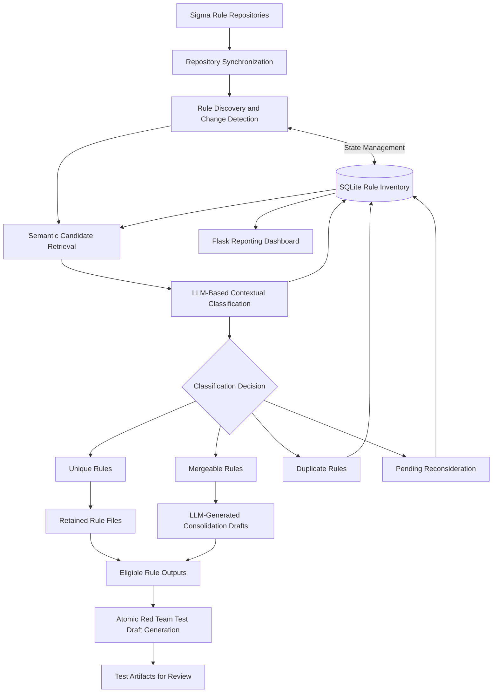

<h1 align="center">Sigma Genie</h1>

<h3 align="center">
LLM-Powered Sigma Rule Optimization & Automated Detection Validation
</h3>

<p align="center">
AI-assisted detection engineering for security operations teams.
</p>

<p align="center">
  
  
  
  
  
</p>

> **Project Type:** Freelance AI Engineering Project  
> **Repository Type:** Technical Portfolio & Architecture Showcase
>
> This repository documents the project's capabilities and high-level design.
> The proprietary source code is not publicly available.

---

## Project Overview

Sigma Genie applies Large Language Models (LLMs) and semantic similarity techniques to the management and optimization of Sigma detection rules.

The system combines automated rule analysis, optimization, validation support, and reporting in a unified engineering workflow.

It is designed to support detection engineers, Security Operations Centers (SOCs), and security content engineering teams.

## Business Problem

Maintaining detection rules across multiple repositories creates several challenges:

- Duplicate and overlapping detection logic.
- Increased manual review and maintenance effort.
- Inconsistent rule organization.
- Difficulty tracking changes and validation coverage.
- Limited visibility into the overall detection rule inventory.

Sigma Genie addresses these challenges through AI-assisted analysis and automated processing.


## My Contributions

**Role: Sole AI Engineer & End-to-End Developer**

Independently designed, developed, tested, and delivered the complete system as a freelance AI engineering project, taking full ownership of its architecture and implementation.

### System Architecture & AI Engineering

- Designed the end-to-end system architecture and processing workflows.
- Integrated Google Gemini for contextual detection-rule analysis and optimization.
- Implemented embedding-based semantic similarity and candidate retrieval.
- Developed automated rule classification, deduplication, merging, and optimization workflows.

### Backend & Automation

- Implemented Git repository integration, synchronization, and incremental rule processing.
- Designed SQLite-based persistent state management, metadata tracking, and processing history.
- Developed automated Atomic Red Team test generation and rule association.
- Integrated the AI pipeline, database, automation, and reporting components.

### Full-Stack Development & Delivery

- Built the Flask-based dashboard and frontend for monitoring, filtering, and reporting.
- Conducted end-to-end testing, debugging, and system integration.
- Managed project configuration, deployment preparation, and client delivery.

**Project Status:** Successfully delivered and deployed in the client's environment, with operational status confirmed by the client.

## Key Capabilities

| Capability | Description |
| --- | --- |
| Repository Integration | Synchronizes detection rules from multiple repositories. |
| Incremental Processing | Identifies new and modified rules using content hashes. |
| Semantic Similarity | Retrieves related detection rules using embeddings. |
| LLM-Based Classification | Assesses relationships between rules through contextual AI analysis. |
| Rule Optimization | Supports consolidation and duplicate management. |
| Validation Support | Generates and associates Atomic Red Team tests. |
| Persistent Tracking | Maintains rule metadata and processing state. |
| Reporting | Provides status monitoring, filtering, and data exports. |


## System Architecture

Sigma Genie combines deterministic data processing, 
semantic retrieval, LLM-based decision-making, 
persistent state management, and analyst reporting.



### Architecture Highlights

- **Incremental Processing:** Content hashing identifies
  new and modified rules for analysis.

- **Semantic Retrieval:** Embedding-based similarity
  retrieves relevant candidates before contextual
  LLM analysis.

- **Hybrid AI Decision-Making:** Deterministic processing
  is combined with structured LLM-based classification
  and conditional content generation.

- **Persistent State:** SQLite maintains rule inventory,
  metadata, and processing status across runs.

- **Review Artifacts:** Selected rules, consolidation
  drafts, and generated test drafts support subsequent
  analyst review.

- **Reporting Layer:** A dedicated Flask dashboard
  presents rule inventory and processing status.

> This diagram represents a high-level conceptual
> architecture. Proprietary implementation details,
> client data, and internal configurations are excluded.
```

The diagram illustrates the conceptual processing workflow rather than the proprietary implementation.

## AI & Machine Learning Approach

### Semantic Candidate Retrieval

Embedding-based similarity is used to identify related rules before contextual analysis.

This approach narrows the candidate search space and helps avoid unnecessary LLM comparisons.

### Contextual Classification

The LLM evaluates detection-rule relationships beyond exact textual matching, supporting the identification of redundant, related, and distinct detection logic.

### Hybrid Engineering Approach

The system combines deterministic processing with AI-assisted decisions rather than relying exclusively on an LLM.

Content hashing, persistent state, semantic retrieval, and structured processing complement the AI analysis pipeline.

## Engineering Highlights

- Incremental processing of new and modified content.
- Separation of deterministic logic and LLM-based analysis.
- Persistent metadata and processing history.
- Structured AI outputs for downstream processing.
- Automated associations between rules and validation tests.
- Centralized reporting and operational visibility.

## Technical Stack

| Category | Technologies |
| --- | --- |
| Programming | Python |
| Generative AI | Google Gemini API |
| Semantic Retrieval | Text Embeddings |
| State Management | SQLite |
| Web Dashboard | Flask, HTML, CSS, JavaScript |
| Data Formats | YAML, JSON, CSV |
| Version Control | Git, GitHub |
| Security Frameworks | Sigma, Atomic Red Team |

## Business Value

The system is designed to:

- Reduce repetitive detection-rule review.
- Support more consistent rule management.
- Simplify detection content optimization.
- Assist security teams with validation workflows.
- Improve visibility into rule inventory and processing status.

## Confidentiality

This repository is a technical project showcase.

Production source code, proprietary prompts, credentials, internal configurations, and customer-specific information are excluded.

No commercial source code or confidential datasets are distributed through this repository.

## Author

**Ziad Muhammed Saqr**  
AI Engineer | Machine Learning & Generative AI

- [LinkedIn](https://www.linkedin.com/in/ziadmuhammedsaqr/)
- [GitHub](https://github.com/Zsaqr)
